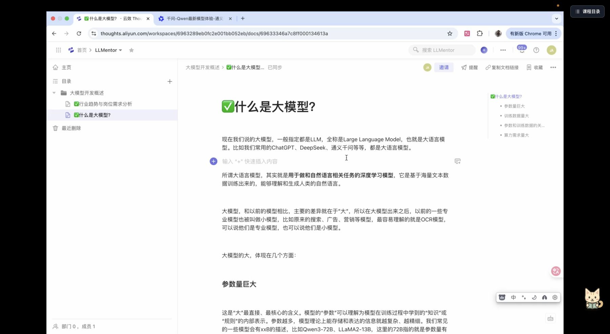

# 小鹅通课程目录搬到视频右侧


边看视频，边找课程。把视频下方的目录搬到右侧，全屏也能搜索、切课；收起后，右下角的小猫帮你保留入口。

**1.11.0** · [安装脚本](https://greasyfork.org/zh-CN/scripts/600209) · [MIT 许可证](LICENSE) · [更新记录](CHANGELOG.md)

## 一眼看懂


以上是同一课程的真实 Chrome 页面截图：左侧为未启用本脚本，右侧为启用 1.11.0。截图裁掉顶部账号导航，并隐藏账号水印；其余页面内容为实际渲染。

## 全屏也能找课

右上角「课程目录」入口一直保留。展开后视频与目录左右排列，目录铺满屏幕高度；直接搜索课程名，点击结果切课。


## 收起成右下角的小猫

点击「收起」后，视频恢复完整宽度，小猫默认在右下角，全屏时留出底部控制条的位置。可在页面内拖动，点击小猫或全屏右上角的入口重新展开。



## 章节更好找

章节标题用柔和浅色区分，展开的课时用同色系淡底与细分隔线承接。「当前学习」继续保持蓝色高亮，搜索或排序后章节颜色不变。


## 安装与操作

1. 在桌面版 Chrome 安装 [Tampermonkey（油猴）](https://www.tampermonkey.net/)。
2. 打开 [GreasyFork 脚本页面](https://greasyfork.org/zh-CN/scripts/600209)，点击安装并按油猴提示完成。
3. 刷新小鹅通课程学习页。

也可从 [GitHub 直接安装](https://raw.githubusercontent.com/joeljhou/xiaoe-catalog-right/main/xiaoe-catalog-right.user.js)。只启用一份同名脚本；其他会修改目录布局的增强脚本也可能冲突。

| 操作 | 效果 |
| --- | --- |
| 拖动目录左、右边缘 | 调整宽度，最高 640px |
| 双击边缘 | 恢复默认宽度 |
| 点击「收起」 | 目录变成右下角小猫 |
| 拖动／点击小猫 | 移动小猫／展开目录 |
| 全屏右上角「课程目录」 | 展开或收起全屏目录 |
| 搜索框输入关键词、回车或点击放大镜 | 使用原站搜索并切课 |

普通页面目录内嵌在网页中，高度与完整播放器底边对齐，最高 800px；窄页面会排列在视频下方。顶部、底部、四角和标题栏不支持拖动。1.11.0 已移除桌面悬浮与「嵌回网页」。

## 隐私与兼容性

播放偏好保存在浏览器本地，搜索沿用小鹅通原站接口。脚本不添加统计或数据上传，需要你已登录并拥有对应课程的访问权限。

适用于小鹅通电脑端课程学习页。站点整页刷新或跳转会退出全屏，站点改版可能影响兼容性。可在脚本顶部 `CONF` 中修改默认宽度和上限。

## 发布与验证

源代码位于 `main` 分支的 `xiaoe-catalog-right.user.js`。发布时更新 `@version`，再提交、推送；GreasyFork 通过 GitHub Raw 链接自动同步。中文安装说明来自 [docs/greasyfork-description.md](docs/greasyfork-description.md)。

```sh
node --check xiaoe-catalog-right.user.js
```

1.11.0 本地模拟页面通过 37 项检查，覆盖右下角默认位置、窗口变化、拖动与点击、键盘操作、仅左右调宽、内嵌高度、搜索、全屏与切课回归；另在用户 Chrome 的真实课程页检查内嵌布局、网页全屏、搜索和收起入口，并截图。模拟测试与单个课程实测不能代表所有课程页。

Logo 为原创 SVG，`assets/` 包含源文件及多尺寸 PNG；脚本内嵌 64px 图标，无需外部图片请求。
