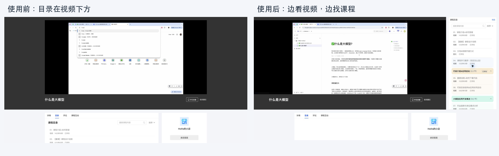
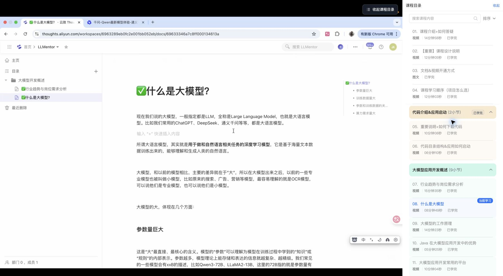
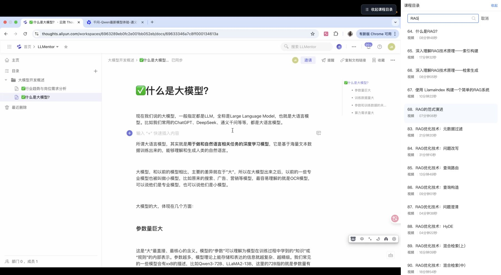

# 小鹅通课程目录搬到视频右侧


边看视频，边找课程。把视频下方的目录搬到视频旁，默认右侧，也可切换到左侧，全屏也能搜索、切课；收起后，同侧的「课程目录」标签保留入口。

**1.13.2** · [安装脚本](https://greasyfork.org/zh-CN/scripts/600209) · [MIT 许可证](LICENSE) · [更新记录](CHANGELOG.md)

## 30 秒看效果

中文配音演示：目录左右切换、同侧收起展开、网页全屏搜索。

https://github.com/user-attachments/assets/7f9eda5f-6562-4dd2-8f0f-64782e129e95

[观看或下载中文配音视频](docs/videos/xiaoe-catalog-promo-x-zh-voice.mp4) · 30 秒 · 1080p · AI 合成配音

## 一眼看懂



以上是同一课程的真实 Chrome 页面截图：左侧为未启用本脚本，右侧为启用 1.11.1。截图裁掉顶部账号导航，并隐藏账号水印；其余页面内容为实际渲染。

## 自选目录位置

标题栏提供左侧目录、右侧目录和收起三个图标，悬停显示文字说明，选中的位置以蓝色高亮。切换立即生效，刷新、切课和全屏沿用选择；默认仍为右侧。窄页面继续将目录放在视频下方，恢复宽屏后回到所选侧。收起后在播放器同侧边缘显示「课程目录」标签。

## 全屏也能找课

目录展开时使用标题栏的收起图标；收起后，在全屏同侧边缘点击「课程目录」标签重新展开。展开后视频与目录左右排列，目录铺满屏幕高度；直接搜索课程名，点击结果切课。





## 同侧收起，原侧展开

收起按钮跟随目录所在侧：左侧目录的按钮在标题栏左端，右侧目录的按钮在右端。点击收起图标后，视频恢复完整宽度，播放器同侧靠近顶部保留蓝色「课程目录」竖标签：左侧目录收起在左边，右侧目录收起在右边。点击整个标签即可恢复目录，保留宽度、搜索内容和滚动位置。

普通页面标签随播放器滚动，全屏标签贴同侧屏幕边缘；窄页面展开后仍排列在视频下方。支持 Tab、Enter 和空格操作，收起与展开后焦点跟随对应按钮。本版移除小猫及右上角重复入口。

## 章节更好找

独立课时、章节标题与展开课时统一左右缩进，章节间距保持紧凑。章节标题用柔和浅色区分，展开的课时用同色系淡底与细分隔线承接。「当前学习」继续保持蓝色高亮，搜索或排序后章节颜色不变。


## 安装与操作

1. 在桌面版 Chrome 安装 [Tampermonkey（油猴）](https://www.tampermonkey.net/)。
2. 打开 [GreasyFork 脚本页面](https://greasyfork.org/zh-CN/scripts/600209)，点击安装并按油猴提示完成。
3. 刷新小鹅通课程学习页。

也可从 [GitHub 直接安装](https://raw.githubusercontent.com/joeljhou/xiaoe-catalog-right/main/xiaoe-catalog-right.user.js)。只启用一份同名脚本；其他会修改目录布局的增强脚本也可能冲突。

| 操作 | 效果 |
| --- | --- |
| 点击标题栏的左侧／右侧目录图标 | 选择目录位置，自动记住；悬停图标显示文字说明 |
| 拖动目录左、右边缘 | 调整宽度，最高 640px |
| 双击边缘 | 恢复默认宽度 |
| 点击标题栏的收起图标 | 收起到播放器同侧的标签 |
| 点击同侧「课程目录」标签 | 恢复目录，保留搜索、滚动和宽度 |
| 搜索框输入关键词、回车或点击放大镜 | 使用原站搜索并切课 |

普通页面目录内嵌在网页中，高度与完整播放器底边对齐，最高 800px；窄页面会排列在视频下方。顶部、底部、四角和标题栏不支持拖动。1.11.0 已移除桌面悬浮与「嵌回网页」。

## 隐私与兼容性

目录位置与播放偏好保存在浏览器本地（同一站点内记忆），搜索沿用小鹅通原站接口。脚本不添加统计或数据上传，需要你已登录并拥有对应课程的访问权限。

默认仅匹配 `https://*.pc.xiaoe-tech.com/p/t_pc/course_pc_detail/*`，油猴与 Greasy Fork 可据此识别适用站点。自定义域名课程需在油猴中打开脚本的「设置 → 用户匹配」，添加该课程域名的具体规则，例如 `https://你的课程域名/p/t_pc/course_pc_detail/*`。

适用于小鹅通电脑端课程学习页。站点整页刷新或跳转会退出全屏，站点改版可能影响兼容性。可在脚本顶部 `CONF` 中修改默认宽度和上限。

部分独立课时链接没有课程集合上下文，原站不会提供目录。此时脚本保持原页面布局，等真实目录出现后再接管。需要完整目录时，从页面的「包含该课程的还有」进入课程集合，再点击「继续学习」；原站通常会自动补上 `product_id`。

## 发布与验证

源代码位于 `main` 分支的 `xiaoe-catalog-right.user.js`。发布时更新 `@version`，再提交、推送；GitHub 的 `push` Webhook 通知 GreasyFork 从 GitHub Raw 链接同步代码和说明，无需再手动粘贴。代码更新需递增 `@version`；只改文档不会产生新的脚本版本。中文安装说明来自 [docs/greasyfork-description.md](docs/greasyfork-description.md)。

当前发布链路：`git push origin main` → GitHub `push` Webhook → Greasy Fork 拉取脚本及附加说明 → 发布新版本。无需 GitHub Actions 或手动粘贴脚本。

配置位置与要点：

| 位置 | 配置 |
| --- | --- |
| Greasy Fork → 管理 → 源代码同步 | 选择 Webhook，源地址为 `https://raw.githubusercontent.com/joeljhou/xiaoe-catalog-right/main/xiaoe-catalog-right.user.js` |
| Greasy Fork → 同步附加信息 | `https://raw.githubusercontent.com/joeljhou/xiaoe-catalog-right/main/docs/greasyfork-description.md`，格式 Markdown |
| GitHub 仓库 → Settings → Webhooks | 使用 Greasy Fork 提供的个人 GitHub Webhook 地址，Content type 为 `application/json`，事件仅 `push`，勾选 Active |

每次代码发布先递增脚本 `@version`，同步 README 版本及 CHANGELOG，再检查语法、提交并推送到 `main`。Webhook 地址可能含个人标识或密钥，不要提交到仓库。推送后在 GitHub Webhook 的 Recent Deliveries 检查响应，再到 Greasy Fork「历史」确认新版本；HTTP 2xx 只说明请求送达，最终以 Greasy Fork 版本为准。已安装用户由油猴的更新检查拉取新版本，需要立即更新时手动检查。


```sh
node --check xiaoe-catalog-right.user.js
```

1.13.2 在 Chrome 本地模拟页通过 10 项回归，覆盖无目录等待超过 12 秒、播放倍速恢复、目录延迟加载、收起时播放器重建、目录删除和重新挂载、左右切换及离开课时页的清理。在真实课程页确认了独立课时缺少目录、经课程集合进入后提供目录的区别。

1.13.0 在本地模拟页通过 35 项检查，覆盖同侧标签位置、左右切换、搜索／滚动／宽度保留、焦点与键盘、页面滚动、全屏进出、窄屏、切课重建及无播放器课时；尚未在真实课程页验证本次变更。

1.12.1 在本地模拟页验证普通页／原生全屏／网页全屏的入口常驻、固定文案、状态图标、键盘操作、收起后退出全屏、窄屏和无播放器场景；尚未在真实课程页验证本次变更。

1.12.0 在本地模拟页面通过 32 项浏览器检查，覆盖左右位置选择、图标与键盘操作、偏好记忆、存储不可用、搜索与滚动保留、调宽、窄屏、原生／网页全屏、收起恢复，以及播放器重建后的目录保留；尚未在真实课程页验证本次变更。

1.11.0 本地模拟页面通过 37 项检查，覆盖右下角默认位置、窗口变化、拖动与点击、键盘操作、仅左右调宽、内嵌高度、搜索、全屏与切课回归；另在用户 Chrome 的真实课程页检查内嵌布局、网页全屏、搜索和收起入口，并截图。1.11.1 的样式调整在真实页测量确认独立课时与章节同宽、同缩进，折叠间距 12px、展开标题与课时间距 8px。模拟测试与单个课程实测不能代表所有课程页。

Logo 为原创 SVG，`assets/` 包含源文件及多尺寸 PNG；脚本内嵌 64px 图标，无需外部图片请求。
